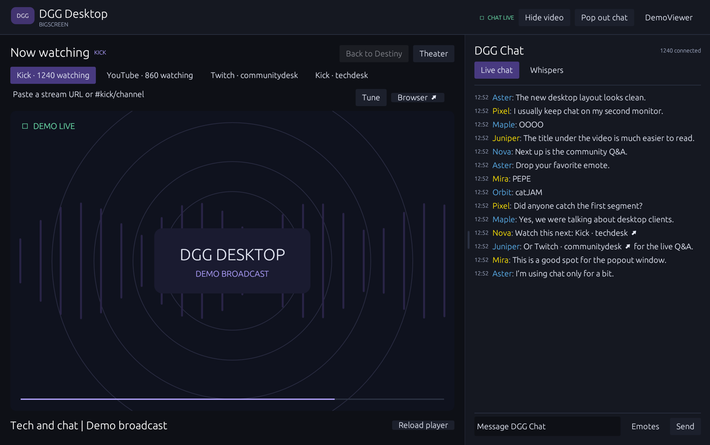
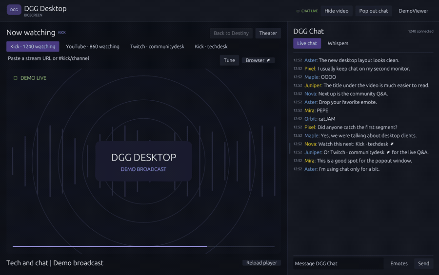
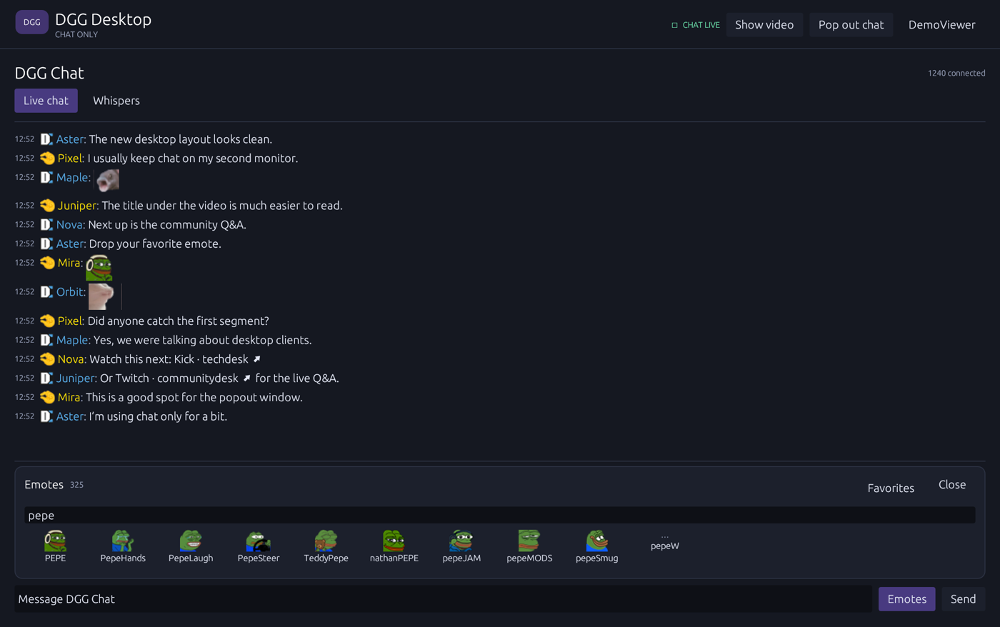
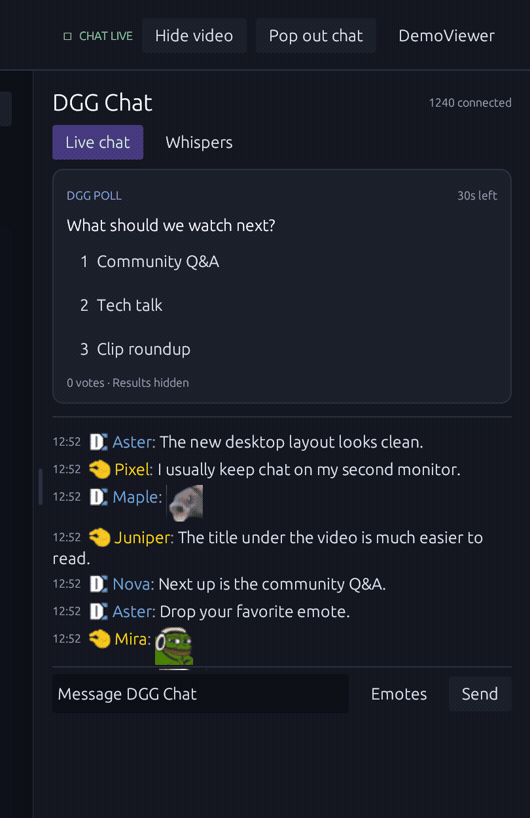
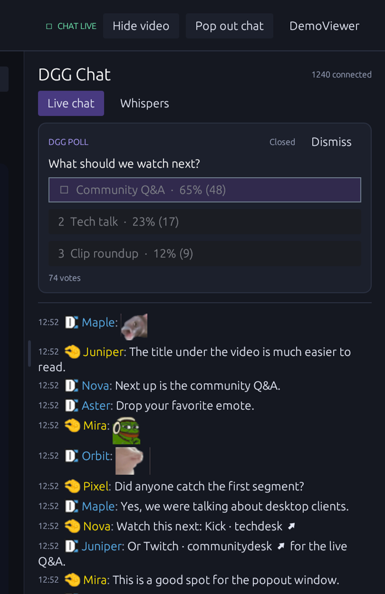

# DGG Desktop

DGG Desktop is a native Rust and egui app for watching streams and participating in Destiny.gg chat. It puts live video, chat, emotes, channel links, and polls in one window. You can move chat to a separate window or unload video for a chat-only session.



The screenshots and GIFs were captured from the macOS interface with sample messages, a sample poll, and a demo video slate.

## Platform status

| Platform | Status | Embedded player and sign-in |
| --- | --- | --- |
| macOS | Tested on Apple silicon. The app bundle targets macOS 14 or newer. | System WebKit |
| Windows | **Fully untested.** Experimental source build. | Microsoft Edge WebView2 |
| Linux | **Fully untested.** Experimental source build for X11. | WebKitGTK 4.1 |

## Start watching and chatting

1. Open **DGG Desktop.app** on macOS, or build from source using the instructions below. Guest chat and Destiny’s available live streams load automatically.
2. Click **Connect DGG account** to send messages, whisper, and vote. Choose the provider already linked to your Destiny.gg account. The app returns to the main screen after Destiny.gg confirms the session.
3. Select **Remember Me** on the Destiny.gg sign-in page if you want to stay signed in across app launches. The app uses macOS Keychain, Windows Credential Manager, or Linux Secret Service depending on the platform. Sign out from the account panel to remove the app’s saved session.

Sign-in takes place on Destiny.gg and its linked provider’s pages. The app uses the resulting DGG session for the chat connection. Google can reject sign-in from embedded browsers. [Google’s desktop OAuth documentation](https://developers.google.com/identity/protocols/oauth2/native-app#disallowed-useragent)

## Video and channels

- The first available Destiny stream is the default. Use the channel tabs to switch between sources. The video title is displayed below the player.
- Click a supported stream link in chat to tune the main player, including from the popped-out window. You can also paste a link into **Tune** or use `/embed link` in the message box.
- Public DGG shorthand such as `#kick/techdesk` or `#twitch/communitydesk` adds a channel tab. **+** reveals tabs that do not fit. Each tab expires three hours after its latest mention. Repeat posts extend the timer, and startup can discover links from recent chat history.
- **Back to Destiny** returns to the default source. **Theater** expands the player, **Reload player** reloads the current embed, and **Browser** opens the stream at its provider.

| Provider | Supported targets |
| --- | --- |
| Kick | Channels and supported VOD links |
| YouTube | Watch, live, Shorts, and embed links with video IDs |
| Twitch | Channels, VODs, and clips |
| Rumble | Embed URLs |

## Chat only and popout

Click **Hide video** in the header to unload the player and stop fetching video. Docked chat expands to fill the window, and popped-out chat stays in its separate window. Chat and emote images still use the network. **Show video** restores the selected stream. The app remembers your chat-only preference between launches.



- **Pop out chat** opens a separate native window. Click **Dock** or close the popout to return it to the main window.
- Drag the divider left to widen docked chat or right to narrow it. The app remembers the width.
- Click **Whispers** to read messages received during the current session. Use `/w nickname message` to send one and `/r message` to reply to your most recent correspondent.
- Click a username to insert a mention. The username context menu also offers **Whisper** and **Ignore user**. Timestamps, emote animation, and the ignore list are managed in preferences.

## Emotes and flairs

Click **Emotes** to search the DGG catalog. Click an available emote to add it to your draft, or right-click to favorite it. Type the first few letters of an emote and press **Tab** to complete it. For usernames, start with **@**.

The app fetches emotes and flairs from the DGG CDN and reads sprite dimensions and timing from DGG’s stylesheet. The native renderer approximates some website-specific CSS effects. macOS decodes AVIF, including animated AVIF. The experimental Windows and Linux decoder handles PNG, JPEG, GIF, and WebP. AVIF emotes use their text fallback on those platforms.



## Polls

Active polls appear above the chat transcript. Sign in and click an option, or send its number while voting is open. The app waits for DGG to confirm your vote. Hidden polls show the number of votes cast while they are open, then reveal the results when the server publishes them. The app also labels polls that use subscriber weighting.





## Build from source

Install [Rust with rustup](https://rustup.rs/) and use a current stable toolchain. Run the commands from the directory containing `Cargo.toml`.

### macOS

Install the Xcode Command Line Tools, then run:

```sh
cargo run --locked
```

To build an ad hoc signed app bundle in `dist/DGG Desktop.app`:

```sh
./scripts/bundle-macos.sh
```

### Windows · fully untested

Use the MSVC Rust toolchain with the C++ build tools from Visual Studio. Install the Evergreen WebView2 Runtime if it is missing. [Microsoft’s WebView2 runtime guide](https://learn.microsoft.com/en-us/microsoft-edge/webview2/concepts/distribution)

```powershell
cargo run --locked
cargo build --release --locked
```

Cargo places the release executable in `target\release\dgg-desktop.exe`.

### Linux · fully untested

Use an X11 session with GTK 3, WebKitGTK 4.1, OpenSSL, and D-Bus development libraries. An XWayland session needs an available X11 display. Remembered sessions require a running Secret Service provider such as GNOME Keyring. [Wry platform requirements](https://docs.rs/wry/0.57.1/wry/#platform-considerations)

For Debian or Ubuntu releases with WebKitGTK 4.1 packages:

```sh
sudo apt install build-essential pkg-config libgtk-3-dev libwebkit2gtk-4.1-dev \
  libssl-dev libdbus-1-dev libxkbcommon-dev libgl1-mesa-dev
cargo run --locked
cargo build --release --locked
```

Cargo places the release executable in `target/release/dgg-desktop`.

## Troubleshooting

| Symptom | What to try |
| --- | --- |
| The chat composer says **Sign in to chat** | Click **Connect DGG account** and finish the linked provider’s sign-in flow. |
| A stream is blank, offline, or blocked from embedding | Click **Reload player** or open the source with **Browser**. Another Destiny source may be listed in the channel tabs. |
| Chat displays emote names | Give the CDN catalog time to load, or use **Refresh assets** in preferences. |
| Chat is disconnected | The app retries automatically. Hover over the connection status for details. |
| Linux cannot create the player or the sign-in view | Check that GTK and WebKitGTK are installed and that an X11 display is available. |
| Sign-in works but the session is forgotten on Linux | Check that your desktop Secret Service is running and its collection is unlocked. |

## Code and verification

- `src/app.rs` contains the interface and routes chat, poll, and player state.
- `src/chat.rs` handles the chat connection and DGG message formats. `src/channels.rs` tracks temporary channel tabs.
- `src/player.rs` resolves stream links and manages the embedded player.
- `src/account.rs` handles sign-in and storage of the DGG session. `src/assets/` contains the native and portable image decoders.

```sh
cargo fmt --check
cargo clippy --locked --all-targets -- -D warnings
cargo test --locked
```

To run the opt-in network checks against the live guest WebSocket and CDN:

```sh
cargo test --locked -- --ignored --nocapture
```

The network checks read public chat and download emote assets. The Windows and Linux source paths have had **no build or runtime testing** on those platforms.
